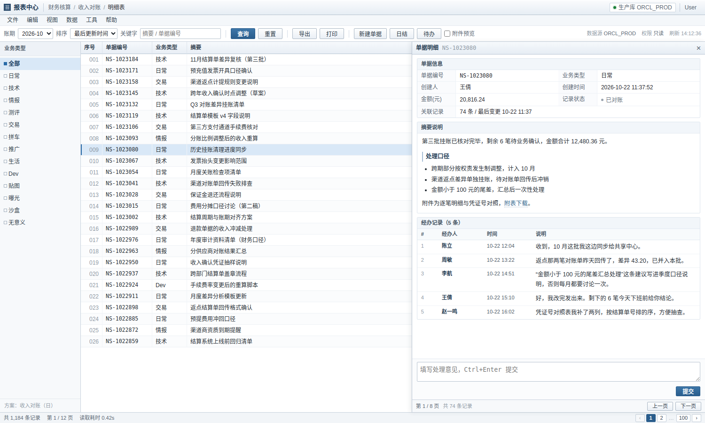

# NodeSeek Slackoff Web

[](LICENSE)

NodeSeek 论坛的第三方 Web 客户端，界面做成一套老旧的内部报表系统「收入对账明细表」：
帖子列表变成单据列表，正文和楼层变成单据明细，发帖回帖变成新建单据与处理意见。



> 界面示意（示例数据）。左列「单据」是帖子，右侧「经办记录」是楼层。

> **Vibe Coding 项目**
> 代码几乎全部由 AI 编码助手在对话中生成，作者只负责提需求、验收和少量修补。
> 它能跑，但结构、边界处理和测试覆盖都按「够用」的标准写，请自行评估后再用。

## 特性

- 列表、板块筛选、翻页、关键字过滤；标题进「摘要」列，浏览数与评论数映射成金额与状态
- 明细抽屉：正文 + 全部楼层，图片默认折叠成 `▸ 图1`，点开查看，可一键全部展开
- 正文里的链接可直接点击：外链新标签打开，指向站内帖子的链接在当前窗口打开并定位到楼层
- 自带 Markdown 编辑器：工具栏、编辑/预览切换、`Ctrl+B/I/K` 快捷键、草稿自动保存，回帖框共用同一套操作
- 受限帖子在列表里用 `Lv1` 标出，明细里给出「需要 LvN / 需要认证」的提示
- 待办：「抄送我的 / 待我处理 / 系统消息」三栏，工具栏显示未读数，点条目直接跳到对应楼层
- 发帖、回帖、每日签到（均需本地认证，手动触发）
- 老板键：`Esc` 弹出「查询执行中」遮罩，再按一次恢复
- 全程本地运行，页面不直连图床、不带统计脚本，浏览数据只在本地缓存

## 部署

需要 Python 3.9+。

```bash
git clone <repo-url> && cd report-center
python3 -m venv .venv && . .venv/bin/activate
pip install -r requirements.txt
python report.py
```

打开 <http://127.0.0.1:8765/>。

局域网访问：

```bash
python report.py --host 0.0.0.0 --port 8765 --token <随机串>
# http://<内网IP>:8765/?k=<随机串>
```

需要常驻的话，仓库里的 `report-center.service` 是用户级 systemd unit（默认按
`~/projects/report-center` 和 `127.0.0.1:8765` 写的），复制到 `~/.config/systemd/user/` 即可。

## 登录

站点登录需要人机验证，无法在程序里完成，所以不做账号密码，改成一次性粘贴会话 Cookie：

1. 浏览器登录站点，`F12` → Network → 任选一个请求 → 复制请求头里的 `Cookie` 整行；
2. 打开页面，点右上角 `User`（未登录时的显示）；
3. 粘贴进去，验证并保存。

凭据存在 `~/.config/report-center/session.json`（权限 0600），只在本地。Cookie 失效后，
任何写操作都会提示重新认证。

## 使用边界

- **个人自用**：请勿用于批量抓取、自动发帖、刷签到，也不要用它同时操作多个账号。
- **不提供在线服务**：作者不托管任何实例，也不代管他人的 Cookie 或账号。
- **写操作手动触发**：发帖、回帖、签到都需要你在本地认证后自己点，程序里没有定时任务。
- **与官方无关**：本项目未经 NodeSeek 官方授权或认可，站点随时可能改版导致失效。
- **风险自担**：使用本工具可能不符合目标站点的服务条款，由此产生的一切后果由使用者自行承担。

## 说明

- 解析依赖目标站点当前的页面结构，站点改版即失效。
- 需要在能正常访问目标站点的网络环境下运行。

## License

WTFNMFPL（Do What The Fuck You Want To But It's Not My Fault Public License）——
想干嘛就干嘛，但出了问题别找我，见 [LICENSE](LICENSE)。SPDX 标识：`WTFNMFPL`。
